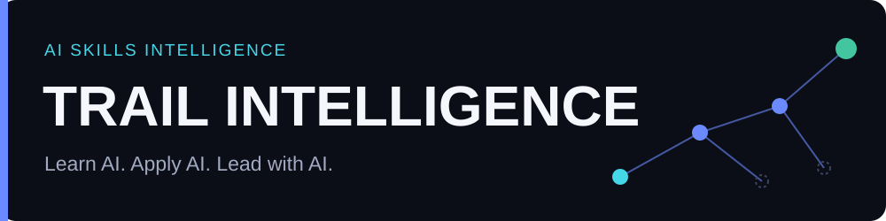

# TRAIL Intelligence



> **Mesurer, développer et prouver les compétences IA pratiques d'un professionnel** | **Statut :** en production, évaluateur IA en mode heuristique (clé LLM à brancher) · [application](https://trail-intelligence.vercel.app) · [API](https://trail-api-production-7487.up.railway.app/health)
>
> [Architecture](docs/architecture/overview.md) · [Déploiement](docs/deployment) · [Périmètre et limites](docs/product/mvp-scope.md) · [Code source](https://github.com/yassineaqejjaj/trail-intelligence)

**T**raining **R**oadmap for **A**pplied **I**ntelligence & **L**eadership — *Learn AI. Apply AI. Lead with AI.*

Les plateformes de formation mesurent surtout ce qui a été *consommé*. TRAIL mesure ce qu'une personne *démontre* : elle s'évalue, pratique sur des exercices professionnels réalistes, reçoit une évaluation liée à des preuves tirées de son propre texte, s'améliore, puis fait **confirmer** ses compétences par un relecteur humain.

`Assess → Practice → Evaluate → Improve → Prove`

> **État honnête du projet** (novembre 2026). L'application tourne sur **Vercel** (front) et **Railway** (API FastAPI + PostgreSQL). Le parcours complet est fonctionnel et testé : inscription, onboarding, exercice de référence, évaluation, résultats, progression, revue formateur, espace entreprise. **L'évaluateur IA est un évaluateur heuristique par mots-clés** (`LLM_PROVIDER=mock`) en attendant une clé LLM : ses scores sont **provisoires, non calibrés**, et l'interface le dit. Les 20 cas de référence sont synthétiques. Voir [ce qui est vérifié et ce qui ne l'est pas](#7-ce-qui-est-vérifié-et-ce-qui-ne-lest-pas).

## Sommaire

1. [Le produit](#1-le-produit)
2. [Architecture](#2-architecture)
3. [Moteur d'évaluation](#3-moteur-dévaluation)
4. [Sécurité et vie privée](#4-sécurité-et-vie-privée)
5. [Démarrer en local](#5-démarrer-en-local)
6. [Déployer et exploiter](#6-déployer-et-exploiter)
7. [Ce qui est vérifié et ce qui ne l'est pas](#7-ce-qui-est-vérifié-et-ce-qui-ne-lest-pas)
8. [Feuille de route](#8-feuille-de-route)

---

## 1. Le produit

| Écran | Ce qu'il fait |
| --- | --- |
| **Dashboard** | Constellation des 11 domaines IA (prérequis, niveaux, état), prochaine action recommandée avec explication, parcours, assessments récents |
| **12 métiers, 3 langues** | Product Manager, UX/UI, Développeur, Data Analyst, Marketing & Communication, Support client, RH, Finance & Comptabilité, Juridique & Conformité, Ventes, Éducation & Formation, Opérations & gestion de projet : chacun avec son exercice de référence. Interface, contenus, évaluations et e-mails en **anglais, français et arabe (RTL)** |
| **Practice Lab** | Espace d'exercice en trois zones : scénario / grille · éditeur avec sauvegarde automatique · checklist. Révisions, protection contre la perte de travail |
| **Résultats** | Niveau, score par dimension, **preuves citées**, forces, axes d'amélioration, statut (provisoire, en revue humaine, vérifié, preuve insuffisante) |
| **Passport** | Profil de compétences : ce qui est *vérifié* par un humain est distingué de ce qui est *provisoire* |
| **Trainer Studio** | Création d'exercices, grilles versionnées, file de revue, ajustement de niveau avec justification journalisée |
| **Enterprise** | Membres, programmes, compétences agrégées **sur consentement**, jamais pour moins de 3 personnes |

Cadre de compétences versionné : 11 domaines (AI Foundations, Prompt Engineering, Context Engineering, AI Product Discovery, AI Product Delivery, AI-Assisted Development, RAG, Agentic AI, AI Evaluation, Responsible AI, AI Economics), 15 compétences avec prérequis, niveaux 0 à 5, 19 exercices dont 12 baselines (une par métier). Le contenu canonique est en anglais ; les versions fr/ar vivent dans des colonnes `translations` et l'API répond dans la langue demandée (`X-Lang` / `Accept-Language`).

## 2. Architecture

```
Navigateur ──(même origine /api/v1/*)──► Vercel (Next.js 16) ──rewrite──► Railway · trail-api (FastAPI) ──► Railway · PostgreSQL (réseau privé)
                                                                                └─► fournisseur LLM (abstraction `LLMProvider`)
```

* **Front** : Next.js App Router, TypeScript, Tailwind v4, TanStack Query, React Hook Form + Zod. Thème sombre/clair, palette de commandes (⌘K), accessibilité clavier.
* **API** : FastAPI, SQLAlchemy 2, Alembic, JWT en cookie `httpOnly`, journaux JSON structurés. Monolithe modulaire.
* **Cookies de première partie** : le front proxifie `/api/v1/*` vers l'API ; pas de cookie tiers entre domaines.
* **Jobs durables** : une évaluation est une ligne en base (`queued → running → terminal`) ; un *sweeper* relance ce qui est resté bloqué après un redémarrage.

Détails et décisions : [docs/architecture/overview.md](docs/architecture/overview.md).

## 3. Moteur d'évaluation

* Entrée : exercice + grille versionnée + soumission + niveau attendu. Sortie : scores par dimension, preuves, forces, axes, actions.
* **Sortie validée, jamais « réparée »** : JSON → Pydantic → clés de la grille → scores bornés → **chaque citation doit exister dans la soumission**. Sinon : nouvelles tentatives bornées, puis statut `failed`.
* Les retours (forces, axes, actions) sont rédigés **dans la langue de l'utilisateur** ; l'évaluateur heuristique comprend les mots-clés fr/ar des grilles.
* Le **niveau est calculé par la plateforme** à partir du score pondéré, pas choisi par le modèle. Plafond automatique **L3** ; L4+, tentative d'injection de prompt ou faible confiance → **revue humaine**.
* La soumission est traitée comme **non fiable** : transmise comme donnée JSON, instructions système séparées, motifs d'injection détectés.
* Métadonnées stockées : version de prompt, de grille, modèle, tokens, coût, latence, tentatives.
* `make eval` exécute 20 cas de référence **synthétiques** (non validés par des experts).
* Fournisseurs : `mock` (heuristique, par défaut) et `anthropic` (clé `LLM_API_KEY`, **jamais exécuté en conditions réelles**).

## 4. Sécurité et vie privée

Argon2, cookies `httpOnly`/`Secure`, contrôle d'`Origin` sur les méthodes non sûres, limitation de débit (auth et IA), limite de taille des requêtes, autorisation **au niveau de la ressource** (404 pour un autre tenant), journal d'audit, secrets hors dépôt. RGPD : consentement à l'inscription, **export** et **suppression** du compte, agrégats entreprise sur consentement avec seuil k ≥ 3, purge planifiée (`python -m app.admin maintenance`). Pages légales : [confidentialité](https://trail-intelligence.vercel.app/privacy), [conditions](https://trail-intelligence.vercel.app/terms), [méthodologie](https://trail-intelligence.vercel.app/methodology) — **brouillons à faire relire** par un juriste.

## 5. Démarrer en local

Prérequis : Python 3.12+ avec [uv](https://docs.astral.sh/uv/), Node 22+.

```bash
cp .env.example apps/api/.env
cd apps/api && uv sync && make dev           # migre, charge le catalogue + comptes de démo (mots de passe aléatoires affichés une fois)
cd apps/web && npm ci && API_URL=http://localhost:8000 npm run dev
```

Tests :

```bash
cd apps/api && make test && make lint && make eval     # 31 tests (migrations, isolation des tenants, injection, jobs)
cd apps/web && npm run lint && npm run typecheck && npm test && npm run build && npm run e2e
```

## 6. Déployer et exploiter

* **Railway** (API + PostgreSQL) : [docs/deployment/railway.md](docs/deployment/railway.md). Migrations et chargement du catalogue en `preDeployCommand`, healthcheck `/health` (503 tant que base et migrations ne sont pas prêtes).
* **Vercel** (front) : [docs/deployment/vercel.md](docs/deployment/vercel.md). `API_URL` doit exister **au build** (les rewrites sont figés).
* **Premier administrateur** (aucun compte n'est créé par défaut en production) :

```bash
railway run --service trail-api python -m app.admin set-role vous@exemple.com platform_admin
railway run --service trail-api python -m app.admin create-org "Mon organisation"
railway run --service trail-api python -m app.admin add-member vous@exemple.com "Mon organisation" --org-admin
```

* **E-mail** (réinitialisation de mot de passe) : `EMAIL_PROVIDER=resend`, `EMAIL_API_KEY`, `EMAIL_FROM`. Sans cela, la réinitialisation ne peut pas envoyer d'e-mail.
* **Brancher le LLM** : `LLM_PROVIDER=anthropic` + `LLM_API_KEY`, puis `make eval` et une calibration sur des données d'experts avant de s'y fier.

## 7. Ce qui est vérifié et ce qui ne l'est pas

**Vérifié** : 36 tests d'API, 8 tests unitaires front, 4 parcours Playwright (dont un parcours français et le passage à l'arabe/RTL) (inscription → onboarding → exercice → feedback → progression ; injection → revue formateur → compétence vérifiée ; redirection non authentifié), migrations sur PostgreSQL 16, `/health` en production.

**Non vérifié / limites connues** :

* Les traductions fr/ar (interface, légal, exercices) ont été rédigées par IA et **n'ont pas été relues par des locuteurs natifs** ; les exercices des 9 métiers ajoutés n'ont pas été validés par des praticiens de ces métiers.

* Aucune **calibration** de l'évaluateur ; aucune affirmation de fiabilité humaine. Le mode `anthropic` n'a jamais tourné en réel.
* L'envoi d'e-mails n'est pas validé tant qu'un fournisseur n'est pas configuré.
* Limiteur de débit en mémoire : **une seule instance** d'API. Pas de SSO/SCIM, pas de CSP stricte, pas d'audit d'accessibilité automatisé (axe) ni de test de charge.
* Programmes entreprise : définition seulement (pas d'assignation ni de suivi). Pas de génération d'exercices ni de coach IA.
* Les textes légaux sont des brouillons ; DPA, base légale, durées de conservation et DPIA restent à valider.

## 8. Feuille de route

Calibration sur données expertes · fournisseur LLM réel · file de jobs dédiée et Redis · e-mails de relecture · SSO/SCIM · assignation de programmes · audit axe en CI · génération d'exercices relue par un formateur.

Voir aussi [docs/product/roadmap.md](docs/product/roadmap.md).
